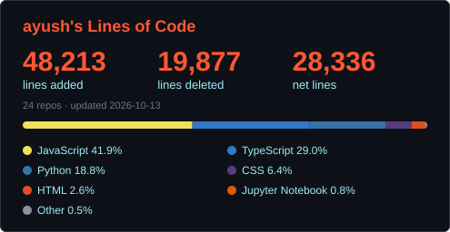

# Lines of Code Card

A free, self-updating **lines-of-code card** for your GitHub profile README. It runs as a GitHub Action in your own repo, so there is no server, database or API key to set up.



## Setup (2 minutes)

1. Open your **profile repo** (the repo named exactly like your username).
2. Create `.github/workflows/loc.yml`:

```yaml
name: Update LOC card
on:
  schedule:
    - cron: '0 3 * * *'
  workflow_dispatch:
permissions:
  contents: write
jobs:
  loc:
    runs-on: ubuntu-latest
    steps:
      - uses: actions/checkout@v4
      - uses: AyushGupta011/loc-card@v1
        with:
          theme: dark
```

3. Go to **Actions → Update LOC card → Run workflow** once to generate `loc.svg`.
4. Add this line to your profile `README.md`:

```md

```

If the repo's Actions can't push, enable **Settings → Actions → General → Workflow permissions → Read and write**.

## Inputs

| Input | Default | Description |
|---|---|---|
| `username` | repo owner | GitHub user to analyze |
| `token` | `github.token` | Works for public repos; use a PAT for more |
| `theme` | `dark` | `dark`, `light`, `radical`, `tokyonight`, `dracula`, `gruvbox` |
| `output` | `loc.svg` | Where the SVG is written |
| `exclude_repos` | | Comma-separated repo names to skip |
| `include_forks` | `false` | Count forks too (only your commits) |
| `hide_deleted` | `false` | Hide the deleted-lines column |
| `show_languages` | `true` | Show the language bar |
| `commit` | `true` | Commit the SVG back to the repo |

Example with options:

```yaml
- uses: your-github-username/loc-card@v1
  with:
    theme: tokyonight
    exclude_repos: 'old-project,scratch'
    hide_deleted: 'true'
```

## How it works

```
cron → Action → GitHub REST API
                 ├─ /users/{u}/repos                 (owned, non-fork repos)
                 ├─ /repos/{r}/stats/contributors    (your weekly additions/deletions)
                 └─ /repos/{r}/languages             (bytes per language)
              → renders loc.svg → commits it → README shows it
```

## Limitations

- Counts **public repos you own**. Repos you only contributed to are not included.
- Uses GitHub's contributor stats, so **lockfiles and generated code are counted**, and repos with 10,000+ commits are skipped by GitHub.
- Commits made with an email that isn't linked to your GitHub account aren't attributed to you.
- The language bar is by **bytes of code**, not lines (same as github-readme-stats).
- Repos that GitHub hasn't computed stats for yet are skipped and picked up on the next daily run.
- The card changes daily (the date), so it creates one small commit per day. That counts toward your contribution graph.

## Publishing your own copy to the Marketplace

1. Fork or copy this repo, and replace `your-github-username` in `action.yml`, `README.md` and `examples/loc.yml`.
2. Make sure `action.yml` is in the repo root and the repo is public.
3. Push a tag: `git tag v1 && git push origin v1`.
4. On GitHub: **Releases → Draft a new release**, choose tag `v1`, tick **Publish this Action to the GitHub Marketplace**, pick a category (Utilities), and publish.
5. The Action `name` must be unique across the Marketplace. Rename it if GitHub says it's taken.

When you ship fixes, tag `v1.0.1`, and move the major tag: `git tag -f v1 && git push -f origin v1`.

## License

MIT
